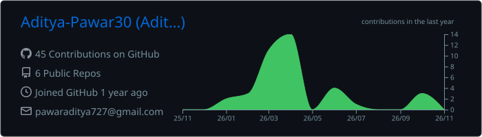
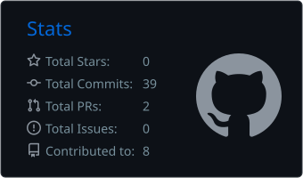

<h1 align="center">Hi, I'm Aditya Pawar 👋</h1>

<h3 align="center">AI Engineer | Backend Developer | Generative AI</h3>

  

  I build practical AI-powered applications and backend systems, with a focus on Machine Learning, Generative AI, RAG pipelines, and intelligent automation.

  I enjoy understanding how systems work internally, solving real-world problems, and turning ideas into working software.

  
  
  

---

## 👨‍💻 About Me

- 🎓 Computer Science Engineering graduate, MIT ADT University, Pune.
- 🤖 Interested in AI Engineering, Machine Learning, and Generative AI.
- 🧠 Hands-on experience building RAG applications, LLM integrations, and AI-powered backends.
- ⚙️ Worked with LangChain, LangGraph, FastAPI, Django REST Framework, and PostgreSQL.
- 🔍 Interested in document processing, intelligent automation, fraud detection, and knowledge-based AI systems.
- 🌱 Continuously learning by building projects and understanding the engineering behind them.

---

## 🛠️ Technical Skills

### Programming Languages

### AI / Machine Learning

### Generative AI & LLM Engineering

### Backend Development

### Databases

### Tools & Development

---

## 🚀 Featured Projects

### 🎓 VIDYA — AI Knowledge Person

An AI-powered learning assistant designed to help students understand study material using uploaded documents.

- PDF ingestion and document processing.
- Text chunking and embedding generation.
- Semantic search using vector databases.
- RAG-based question answering.
- LangGraph-based workflow orchestration.

**Tech:** Python, LangChain, LangGraph, ChromaDB, Hugging Face, LLMs.

---

### 🛡️ Fraud & Risk Intelligence System

An AI-powered proof of concept focused on identifying suspicious financial transactions and potential fraud patterns.

- Backend APIs for investigation workflows.
- Transaction data processing and anomaly detection.
- Risk intelligence and relationship analysis.
- Graph-based customer relationship exploration.

**Tech:** Python, Django REST Framework, PostgreSQL, Neo4j, Machine Learning.

---

### 🪪 KYC Verification System

A document-processing application focused on automating parts of the KYC verification workflow.

- Document data extraction and processing.
- OCR and image validation.
- Backend API integration.
- Structured storage and data handling.

**Tech:** Python, OpenCV, OCR, MongoDB, REST APIs.

---

## 💼 Experience

### AI / ML & Backend Engineering — The DataTech Labs Inc.

**Software Engineer Trainee | January 2026 – July 2026**

- Worked on AI-powered backend applications and business-focused proof of concepts.
- Developed backend APIs and data-processing workflows.
- Explored fraud detection, risk intelligence, and graph-based data relationships.
- Worked with Python, Django REST Framework, PostgreSQL, LangChain, and LangGraph.

### AI Engineering Intern — HCLTech

**College-facilitated internship**

- Implemented Retrieval-Augmented Generation (RAG) workflows.
- Worked with Hugging Face API integrations and LangChain.
- Explored LangGraph for workflow orchestration.
- Practiced document loading, text chunking, prompt engineering, testing, and debugging.
- Built and experimented with AI-powered applications.

---
🔥Commits

<picture>
  <source media="(prefers-color-scheme: dark)" srcset="https://raw.githubusercontent.com/Aditya-Pawar30/Aditya-Pawar30/output/github-snake-dark.svg" />
  <source media="(prefers-color-scheme: light)" srcset="https://raw.githubusercontent.com/Aditya-Pawar30/Aditya-Pawar30/output/github-snake.svg" />
  
</picture>

## 📊 GitHub Statistics

---

## 🤝 Let's Connect

I'm always interested in connecting with developers, AI engineers, and people building interesting technology.

  
  

  Thanks for visiting my profile! ⭐

